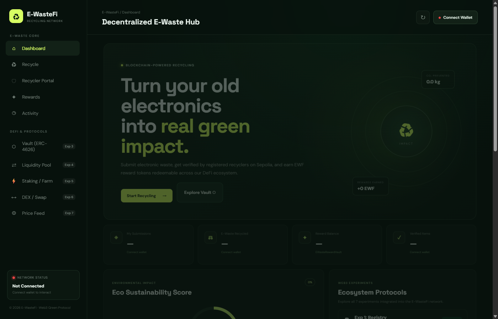
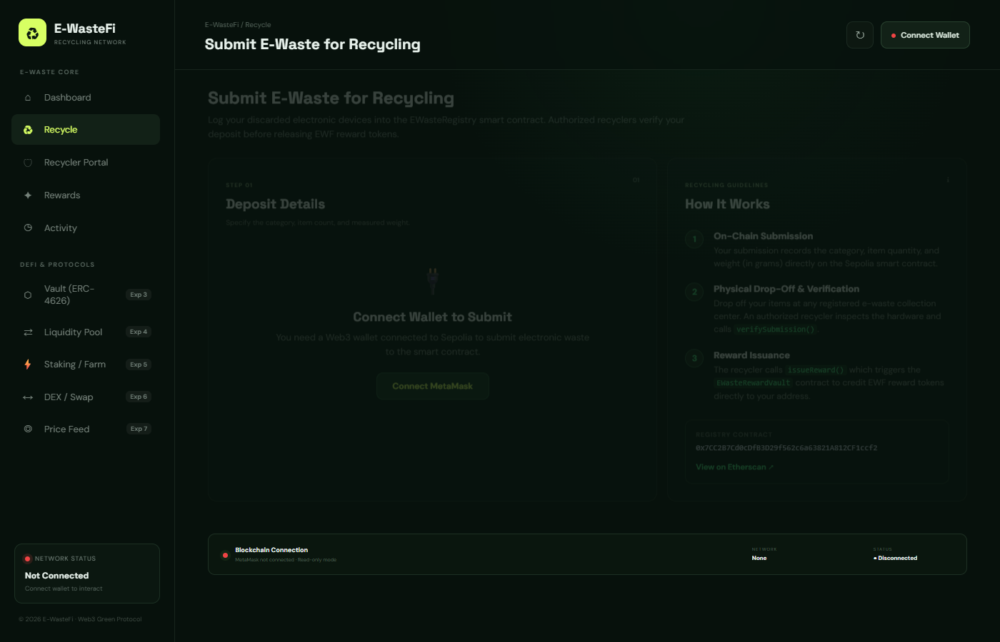
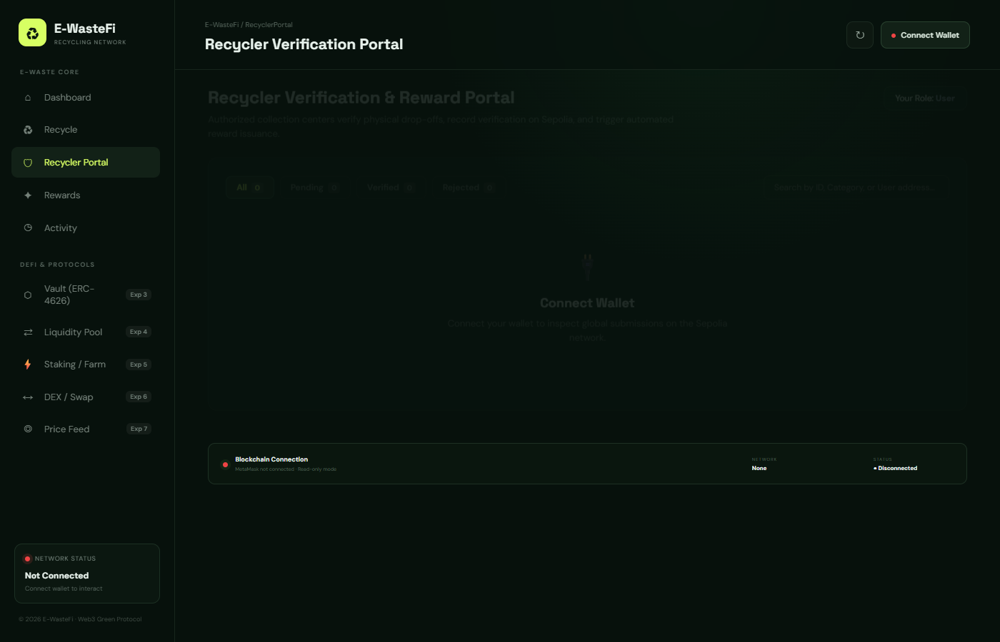
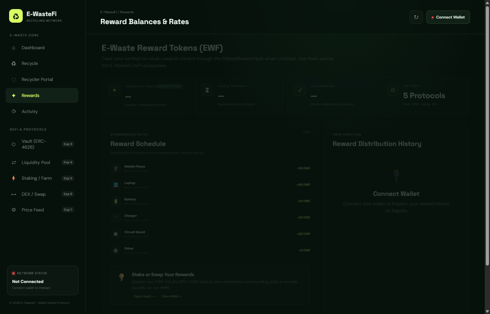
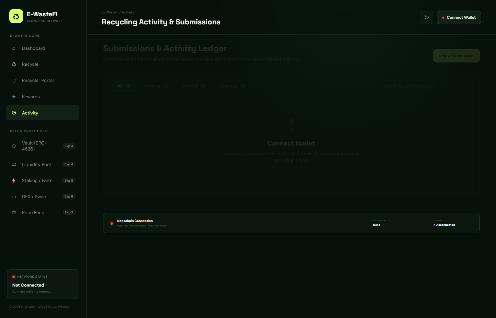
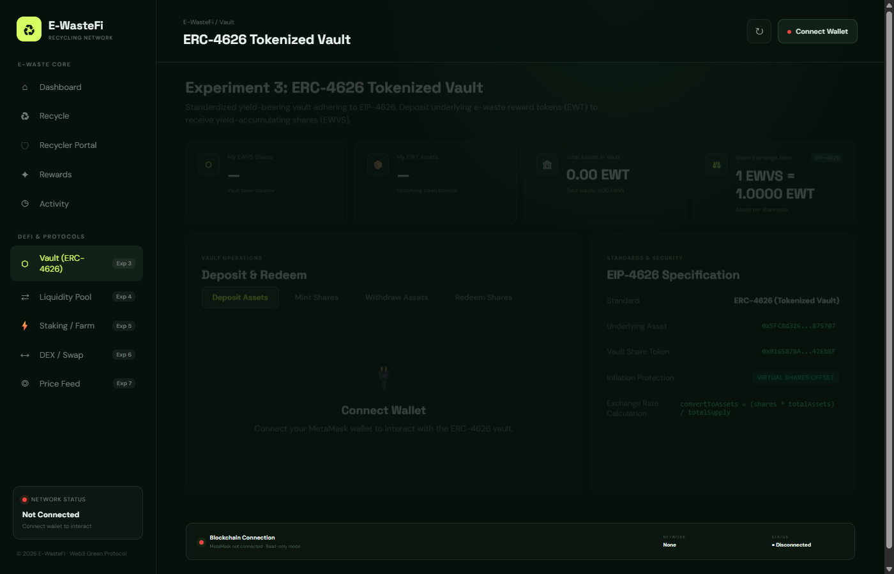
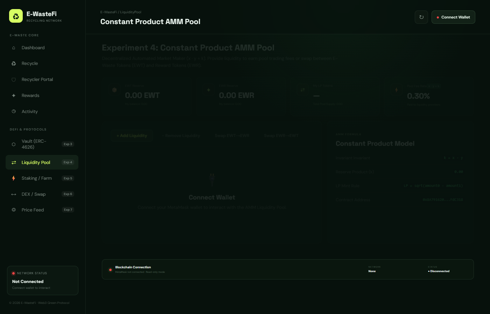
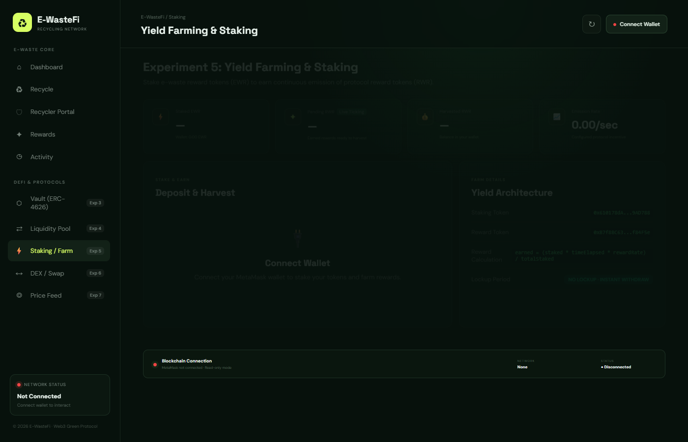
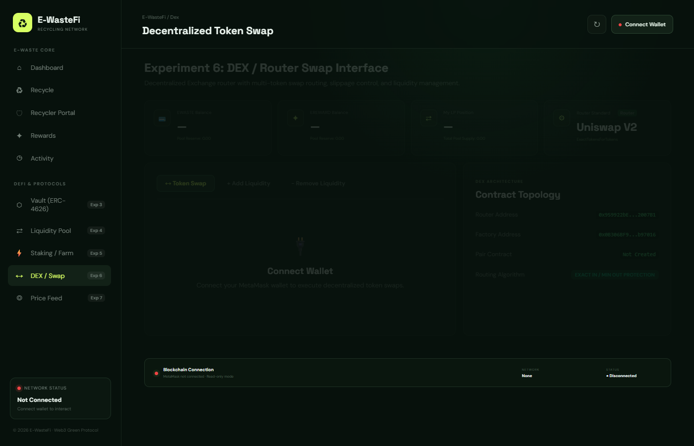
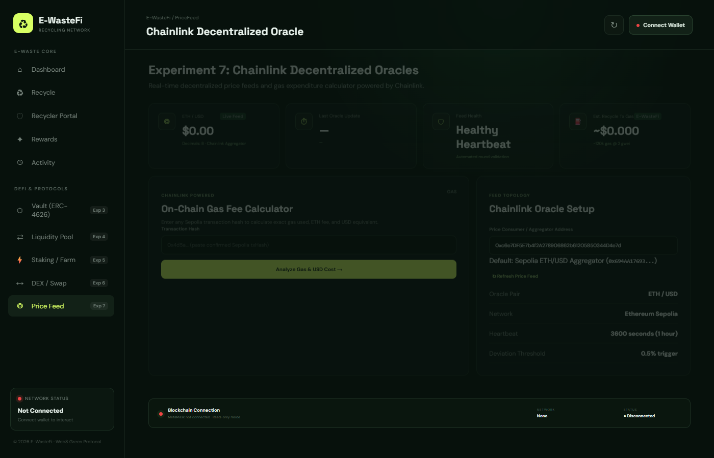

# E-WasteFi — Decentralized E-Waste Recycling & Rewards Protocol

[](LICENSE)
[](https://soliditylang.org/)
[](https://hardhat.org/)
[](https://react.dev/)
[](https://vitejs.dev/)
[](https://docs.ethers.org/v6/)
[](https://openzeppelin.com/contracts/)
[](https://chain.link/)

> **E-WasteFi** is a full-stack decentralized application (DApp) that incentivizes responsible electronic-waste recycling through immutable smart contract logging, role-based recycler verification, transparent reward issuance, tokenized ERC-4626 environmental vaults, automated liquidity provision, DeFi yield farming, and decentralized Chainlink price oracles.

---

## 📸 UI / UX Interface Showcase

### 1. Main Recycling Hub & Eco Dashboard
The primary landing dashboard displaying global recycling metrics, user impact score, token balances, network status, and recent activity.


---

### 2. Experiment 1: E-Waste Submission Portal
Users select an electronic waste category (Mobile, Laptop, Battery, Charger, Circuit Board, Other), enter quantity and weight, view real-time estimated reward calculation, and submit on-chain.


---

### 3. Experiment 1: Authorized Recycler Portal
Authorized recyclers inspect pending submissions, verify physical compliance, or reject fraudulent claims. Verified submissions enable a single-credit on-chain reward issuance.


---

### 4. Experiment 1: Reward Ledger & Schedule
Displays user available balance credited from `EWasteRewardVault`, base category reward matrix, and historical reward distribution receipts.


---

### 5. Experiment 1 & 2: User Activity Audit Trail
Complete personal immutable recycling ledger tracking all submitted devices, verification timestamps, and transaction hashes.


---

### 6. Experiment 3: ERC-4626 Tokenized Vault (EWVS)
Enables users to deposit underlying recycling asset tokens (`EWAT`) to mint yield-bearing shares (`EWVS`), with live asset-to-share preview conversions and physical impact tracking.


---

### 7. Experiment 4: Automated Market Maker (AMM) Pool
Constant-product ($x \times y = k$) liquidity pool supporting `EWT` and `EWR` tokens, automated reserve tracking, liquidity minting/burning, and 0.3% protocol fee swaps.


---

### 8. Experiment 5: DeFi Yield Farming & Staking
Synthetix-style algorithmic continuous staking protocol where users stake `EWR` tokens to earn `RWR` reward tokens calculated per-second with instant harvesting.


---

### 9. Experiment 6: Full Uniswap V2 Decentralized Exchange (DEX)
Production-grade DEX architecture featuring `EWasteFactory`, `EWastePair`, and `EWasteRouter` with canonical token address sorting, slippage tolerance, and deadline protection.


---

### 10. Experiment 7: Chainlink Decentralized Oracle & Gas Fee Analyzer
Live Chainlink AggregatorV3 ETH/USD price feed with staleness heartbeat checks, plus an on-chain gas fee analyzer translating transaction costs into USD.


---

## 🌍 Problem Statement

Electronic waste (e-waste) is the fastest-growing solid waste stream globally, generating over **53 million metric tons** annually. Centralized recycling collection systems suffer from:
- **Lack of transparency** — zero verifiable audit trail for collected materials.
- **Intermediary manipulation** — collection centers can alter weight records or deny reward credits.
- **Inadequate citizen incentive** — consumers lack verifiable economic motivation to surrender old electronics.
- **Siloed databases** — centralized servers are vulnerable to data tampering and downtime.

---

## 💡 Solution Overview

**E-WasteFi** solves these vulnerabilities by deploying immutable business logic to Ethereum-compatible blockchains:
- **Deterministic Recordkeeping:** Every submission is minted as a permanent on-chain struct.
- **Role-Based Recycler Verification:** Only cryptographically authorized recycling facilities can transition a submission from `Pending` to `Verified`.
- **Isolated Reward Vault:** A dedicated `EWasteRewardVault` contract mints reward credits only when invoked by the authenticated registry, preventing duplicate claims.
- **Multi-Network Flexibility:** Operates seamlessly on public testnets (**Ethereum Sepolia**) and local testing environments (**Ganache GUI / CLI / Hardhat**).
- **Comprehensive DeFi Composability:** Implements tokenized vaults (ERC-4626), AMMs, yield farming, decentralized exchanges, and decentralized Chainlink oracles.

---

## 🧪 Experiments Summary (1–7)

| # | Experiment Name | Smart Contracts | Description & Key Formula | Status |
|---|---|---|---|:---:|
| **1** | **E-WasteFi Core DApp** | `EWasteRegistry.sol`<br>`EWasteRewardVault.sol` | On-chain registration, recycler authorization, status state machine (`Pending` $\rightarrow$ `Verified`/`Rejected`), and single-credit reward issuance. | ✅ Verified |
| **2** | **Wallet Integration** | `wallet.js`<br>`TopBar.jsx` | Ethers.js v6 BrowserProvider, multi-account switching (`wallet_requestPermissions`), Sepolia/Ganache/Local network validation, reactive event listeners. | ✅ Verified |
| **3** | **ERC-4626 Yield Vault** | `EWasteAssetToken.sol`<br>`EWasteFiVault.sol` | Tokenized vault issuing `EWVS` shares for `EWAT` assets. Implements `deposit`, `mint`, `withdraw`, `redeem`, `previewDeposit`, and administrative `recordRecyclingImpact`. | ✅ Verified |
| **4** | **AMM Liquidity Pool** | `EWasteToken.sol`<br>`EWasteRewardToken.sol`<br>`EWasteAMM.sol` | Constant-product $x \times y = k$ AMM with internal LP accounting and 0.3% fee: $\Delta y = \frac{0.997 \Delta x \cdot y}{x + 0.997 \Delta x}$. | ✅ Verified |
| **5** | **Yield Farming & Staking** | `EWRToken.sol`<br>`RWRToken.sol`<br>`SimpleYieldFarm.sol` | Algorithmic continuous per-second staking rewards with pro-rata pool distribution, dynamic harvesting, and guaranteed reward pool solvency. | ✅ Verified |
| **6** | **Full DEX Architecture** | `EWASTEToken.sol`<br>`EREWARDToken.sol`<br>`EWasteFactory.sol`<br>`EWastePair.sol`<br>`EWasteRouter.sol` | Uniswap V2 architecture: canonical token sorting, 1,000 minimum liquidity lock to `address(1)`, slippage protection, and deadline verification. | ✅ Verified |
| **7** | **Chainlink Price Oracles** | `MockPriceFeed.sol`<br>`EWastePriceConsumer.sol`<br>`SafeEWastePriceConsumer.sol` | AggregatorV3 interface integration with multi-tier validation (staleness, non-positive, future timestamps) and real-time gas fee USD conversion. | ✅ Verified |

---

## 🛠 Technology Stack

| Layer | Component | Version / Library |
|---|---|---|
| **Smart Contracts** | Language | Solidity `^0.8.28` |
| **Development Toolchain** | Framework | Hardhat `v3.14.0` |
| **Libraries** | Standards & Security | OpenZeppelin Contracts (ERC20, ERC4626, ReentrancyGuard, SafeERC20) |
| **Oracles** | Decentralized Feeds | Chainlink `AggregatorV3Interface` |
| **Frontend Framework** | UI Library | React `19.2.8` |
| **Bundler & Tooling** | Build Tool | Vite `8.2.1` |
| **Blockchain Client** | Web3 RPC Library | Ethers.js `v6.17.0` |
| **Testing** | Test Suite | Mocha `11.8` + Chai `6.2` (41 passing tests) |
| **Code Quality** | Linter | Oxlint `1.75.0` (0 errors) |

---

## 📄 Deployed Smart Contract Addresses

### Public Ethereum Sepolia Testnet (Chain ID: `11155111`)
- **EWasteRegistry:** [`0x7CC2B7Cd0cDfB3D29f562c6a63821A812CF1ccf2`](https://sepolia.etherscan.io/address/0x7CC2B7Cd0cDfB3D29f562c6a63821A812CF1ccf2)
- **EWasteRewardVault:** [`0x4C8027D4fE6339FA9B764cA100af0cD7e20A032c`](https://sepolia.etherscan.io/address/0x4C8027D4fE6339FA9B764cA100af0cD7e20A032c)
- **Chainlink Sepolia ETH/USD Feed:** [`0x694AA1769357215DE4FAC081bf1f309aDC325306`](https://sepolia.etherscan.io/address/0x694AA1769357215DE4FAC081bf1f309aDC325306)

### Local Development Network (Ganache / Hardhat)
Recorded in [`deployments/local.json`](deployments/local.json):
- **EWasteRegistry:** `0x5FbDB2315678afecb367f032d93F642f64180aa3`
- **EWasteRewardVault:** `0xe7f1725E7734CE288F8367e1Bb143E90bb3F0512`
- **EWasteAssetToken (EWAT):** `0x5FC8d32690cc91D4c39d9d3abcBD16989F875707`
- **EWasteFiVault (EWVS):** `0x0165878A594ca255338adfa4d48449f69242Eb8F`
- **EWasteToken (EWT):** `0xa513E6E4b8f2a923D98304ec87F64353C4D5C853`
- **EWasteRewardToken (EWR):** `0x2279B7A0a67DB372996a5FaB50D91eAA73d2eBe6`
- **EWasteAMM:** `0x8A791620dd6260079BF849Dc5567aDC3F2FdC318`
- **SimpleYieldFarm:** `0xA51c1fc2f0D1a1b8494Ed1FE312d7C3a78Ed91C0`
- **EWasteFactory:** `0x0B306BF915C4d645ff596e518fAf3F9669b97016`
- **EWasteRouter:** `0x959922bE3CAee4b8Cd9a407cc3ac1C251C2007B1`
- **SafeEWastePriceConsumer:** `0xc6e7DF5E7b4f2A278906862b61205850344D4e7d`

---

## ⚡ Quick Start Guide

### 1. Installation
```bash
git clone https://github.com/hitenBhurani07/E-WasteFi.git
cd E-WasteFi
npm install
cd blockchain && npm install && cd ..
```

### 2. Run Smart Contract Tests
```bash
npm run test
```
*Executes all 41 unit and integration tests across Experiments 1 through 7.*

### 3. Start Local Blockchain & Deploy
```bash
# Terminal 1 — Start local node
cd blockchain
npx hardhat node

# Terminal 2 — Deploy all contracts
npm run deploy:local
# Or for Ganache GUI: npm run deploy:ganache
```

### 4. Launch the Web3 DApp
```bash
npm run dev
```
Open **[http://localhost:5173/](http://localhost:5173/)** in your browser.

---

## 📁 Repository Structure

```text
E-WasteFi/
├── contracts/active/              # Active modular Solidity contracts
│   ├── Experiment1/               # EWasteRegistry, EWasteRewardVault
│   ├── Experiment3/               # EWasteAssetToken, EWasteFiVault (ERC-4626)
│   ├── Experiment4/               # EWasteToken, EWasteRewardToken, EWasteAMM
│   ├── Experiment5/               # EWRToken, RWRToken, SimpleYieldFarm
│   ├── Experiment6/               # EWASTEToken, EREWARDToken, EWastePair, Factory, Router
│   └── Experiment7/               # MockPriceFeed, EWastePriceConsumer, SafeEWastePriceConsumer
├── scripts/                       # Deployment scripts
│   ├── deploy-all.js              # One-command full protocol deployment
│   ├── deploy-exp1.js – exp7.js   # Experiment-specific deployment scripts
│   └── export-abis.js             # Automated Hardhat ABI to frontend exporter
├── test/                          # Comprehensive Mocha/Chai test suite
│   ├── Experiment1.test.js – Experiment7.test.js (41 passing tests)
├── src/                           # Canonical React/Vite Web3 application
│   ├── blockchain/                # Ethers.js v6 wallet connection & network handlers
│   ├── components/                # Modular UI components (TopBar, Sidebar, StatCards, Modals)
│   ├── config/abis/               # 18 JSON ABI contract interfaces
│   ├── pages/                     # Dedicated experiment pages (Dashboard, Recycle, Vault, DEX...)
│   ├── services/                  # Registry and Vault contract interaction services
│   ├── App.jsx                    # Primary application router & state manager
│   └── main.jsx                   # Application entry point
├── deployments/                   # Deployment records (local.json, sepolia.json)
├── docs/                          # Academic documentation
│   ├── PRACTICAL_RECORD.md        # Comprehensive 31KB laboratory record
│   ├── ARCHITECTURE.md            # Deep system architecture & data flows
│   ├── BLOCKCHAIN_QUICK_REFERENCE.md # Troubleshooting & developer cheat sheet
│   └── screenshots/               # High-resolution screenshots of all 10 views
├── .env.example                   # Environment configuration template
├── LICENSE                        # MIT License
└── package.json                   # Project scripts and dependencies
```

---

## 👥 Authors
- **Hiten Bhurani** — Smart Contract Development, Frontend Integration
- **Dhrijesh Bhusara** — DeFi Architecture, Testing & Documentation

## 📜 License
Licensed under the [MIT License](LICENSE). Copyright © 2026 Hiten Bhurani and Dhrijesh Bhusara.
